# Dependency Map

What depends on what, in what order, and what you must replace.

---

## 1. The graph

```mermaid
graph TD
  subgraph RS["ReplicatedStorage"]
    CFG["Config/*<br/>(19 domains)"]
    UT["Utility/*<br/>BigNumber, Debug, Remotes,<br/>Validation, Signals, ..."]
    TY["Types/*<br/>SlotType, AnimalType, ..."]
  end

  subgraph SSS["ServerScriptService"]
    BS["bootstrap.server.lua"]
    PS["PlayerService"]
    ES["EconomyService"]
    IS["IncomeService"]
    MS["ModifierService"]
    SS["SellService"]
    SS2["SlotService"]
    BSV["BaseService"]
    BLS["BaseLockService"]
    EG["EggService"]
    AN["AnimalService"]
    US["UpgradeService"]
    SM["SlotMenuService"]
    SDS["StandDisplayService"]
    TS["TraitService / MutationService"]
    EV["EventService"]
    TU["TutorialService"]
    NS["NotificationService"]
    CR["CarryRegistry / Grab /<br/>ResetProtection / ToolLock"]
    ST["StealService"]
    BT["BatService / Ragdoll"]
    GS["GearShopService"]
    RB["RebirthService"]
    LB["Leaderboard / TabList"]
    AR["ArenaService / Battle /<br/>Progression"]
    CO["CodesService"]
    DR["DailyRewardsService"]
    PR["PlaytimeRewardsService"]
    SH["ShopService / DoorService"]
    FL["FunnelService"]
    PL["PlayerLogger"]
    AD["Admin/*"]
    LK["ServerLuckService"]
    SE["SettingsService"]
  end

  subgraph CL["StarterPlayerScripts"]
    CB["bootstrap.client.lua<br/>(28 controllers)"]
  end

  WS["Workspace / ServerStorage<br/>(Studio-authored — NOT in this repo)"]
  RM["47 Remotes"]

  BS --> CFG
  BS --> UT
  BS --> RM
  BS --> PS
  BS --> ES
  BS --> SS2
  BS --> BSV
  BS --> EG
  BS --> AN
  BS --> CR
  BS --> SE
  BS --> LK
  BS --> MS
  BS --> IS
  BS --> SS
  BS --> SM
  BS --> US
  BS --> SDS
  BS --> BLS
  BS --> TS
  BS --> EV
  BS --> TU
  BS --> FL
  BS --> PL
  BS --> NS
  BS --> ST
  BS --> BT
  BS --> GS
  BS --> RB
  BS --> LB
  BS --> AR
  BS --> CO
  BS --> DR
  BS --> PR
  BS --> SH
  BS --> AD

  PS --> ES
  ES --> PS
  PS --> CR
  AN --> TS
  AN --> AR
  AN --> TU
  AN --> FL
  AN --> SS2
  AN --> IS
  EG --> AN
  EG --> TS
  AR --> AN
  AR --> BT
  AR --> ST
  AR --> IS
  CO --> GS
  CO --> EG
  CO --> AN
  DR --> CO
  PR --> CO
  SH --> GS
  SM --> SS
  SM --> US
  SDS --> AN

  CB --> RM
  CB --> UT

  BSV --> WS
  EG --> WS
  AN --> WS
  AR --> WS
  GS --> WS
  PL --> RS

  classDef shared fill:#e8f0fe,stroke:#4285f4
  class UT,TY,CFG,RM shared
```



**Read the arrows as "is injected with" / "reads from", not "requires".**
The two-way edges (e.g. `PS <--> ES`) are *not* mutual requires — they are
late-bound `Set<Peer>Service()` injections. That is precisely what keeps the
graph acyclic.

---

## 2. The required initialisation order

This is the **actual** order from `bootstrap.server.lua`, verified line by
line. It is not a suggestion — several steps have hard ordering
requirements, noted in the third column.

### 2.1 Phase 0 — preconditions

| # | Step | Why it must be here |
|---|---|---|
| 0.1 | `StudioTestMode` / `Debug` configured from `Config/Systems/Debug.lua` | Every later step logs through `Debug`. |
| 0.2 | `ConfigValidator.ValidateAll()` | A bad tuning value must be reported before anything reads it. **Hard error in Studio, warning in a live server.** |
| 0.3 | **`createRemotes()`** | The `ReplicatedStorage.Remotes` folder must exist before any service binds an `OnServerEvent`. Called at `bootstrap.server.lua:222`. |
| 0.4 | `Players.CharacterAutoLoads = false` | Must be set before the first player joins, or a character spawns before the profile is loaded. |

### 2.2 Phase 1 — the data spine

| # | Step | Notes |
|---|---|---|
| 1.1 | `EconomyService.Init()` | First service. It owns the money authority. |
| 1.2 | `EconomyService.SetPlayerService(PlayerService)` | Injection, before `PlayerService.Init()`. |
| 1.3 | `PlayerService.Init()` | Stateless until a profile loads. |
| 1.4 | `SlotService.Init()` | The slot pool must exist before bases register their slots. |
| 1.5 | `BaseService.Init()` | |
| 1.6 | `BaseService.Set{PlayerService, SlotService, EggService, AnimalService}` | Injection. |
| 1.7 | `EggService.Init()` | After `BaseService` — the egg service places eggs on bases. |
| 1.8 | `EggService.Set{PlayerService, BaseService, AnimalService, SlotService}` | |
| 1.9 | `AnimalService.Init()` | After `EggService` — animals can be created from eggs. |
| 1.10 | `AnimalService.Set{PlayerService, BaseService, EggService, SlotService}` | |
| 1.11 | `EconomyService.SetBaseService(BaseService)` | |
| 1.12 | `ModifierService.Init()` | Multipliers. |
| 1.13 | `IncomeService.SetModifierService(ModifierService)` | |
| 1.14 | `AnimalService.SetModifierService(ModifierService)` | |
| 1.15 | `StandPresentation.Init()` | |
| 1.16 | `WaterHazard.Init()` | |
| 1.17 | `SellService.Set{PlayerService, SlotService, BaseService, AnimalService, EggService, EconomyService, IncomeService, ModifierService}` | |
| 1.18 | `SellService.Init()` | Called **twice** in the source (`:314` and `:315`) — harmless, `Init()` is idempotent. |
| 1.19 | `SlotMenuService.Set{…}` (8 injections) | |
| 1.20 | `SlotMenuService.Init()` | |
| 1.21 | `UpgradeService.Set{PlayerService, SlotService, BaseService, AnimalService, EconomyService}` | |
| 1.22 | `SlotMenuService.SetUpgradeService(UpgradeService)` | Must be **after** 1.21. |
| 1.23 | `StandDisplayService.Init()` + 5 injections | |
| 1.24 | `SlotMenuService.SetStandDisplayService(StandDisplayService)` | |
| 1.25 | `BaseService.SetBaseLockService(BaseLockService)` | |
| 1.26 | `TraitService.Init()` / `MutationService.Init()` | Before `EventService` — events grant mutations. |
| 1.27 | `EventService.Init()` | |
| 1.28 | `TutorialService.Init()` | |
| 1.29 | `FunnelService` — constructed; `Start()` later | |
| 1.30 | `PlayerLogger` — constructed; `Init()` later (`:1305`) | |
| 1.31 | `NotificationService.Init()` + `SetPlayerService(PlayerService)` | |
| 1.32 | `CarryRegistry.Init()` | |
| 1.33 | `ResetProtectionService.Init()` | |
| 1.34 | `ToolLockService.Init()` | |
| 1.35 | `SettingsService.Init()` | |
| 1.36 | `PlayerGrabService.Init()` | |
| 1.37 | `IncomeService.Init()` + 4 injections | **Late** — it needs the modifier service and the economy. |

### 2.3 Phase 2 — the world

| # | Step | Notes |
|---|---|---|
| 2.1 | Cmdr bootstrap (`require(CmdrBootstrap)`) | `:458`. Admin commands need the services above to already exist. |
| 2.2 | `BaseService.RegisterBases(Workspace)` | `:462`. Requires the Studio `Bases` hierarchy **and** the `Collector` parts. A base without a Collector is a **fatal error** in phase 5. |
| 2.3 | `EggService.RegisterCenter(Workspace)` | `:463`. |
| 2.4 | `BaseLockService.Init()` | `:468` — **must** run after `RegisterBases`. |
| 2.5 | `StealService.SetPlayerService` + `Init()` | `:473-474` — after `RegisterBases`. |
| 2.6 | `BatService.Init()` | `:481`. |
| 2.7 | `GearShopService.Set{PlayerService, EconomyService}` + `Init()` | `:487-489`. |
| 2.8 | `RebirthService.Init()` | `:494`. |
| 2.9 | `LeaderboardService` + `TabListService` injections | `:501-508`. `TabListService` also needs `RebirthService`. |
| 2.10 | `DynamicSlotService` (lazy `require` at `:515`) | |
| 2.11 | `ArenaService` — 9 injections, then `Init()` | `:524-536`. Needs `StealService`, `NotificationService`, `ArenaProgressionService`, `ArenaBattleService`. |
| 2.12 | `CodesService` — 6 injections, then `Init()` | `:541-547`. Needs `GearShopService`. |
| 2.13 | `DailyRewardsService` — 4 injections, then `Init()` | `:554-558`. Needs `CodesService`. |
| 2.14 | `PlaytimeRewardsService` — 4 injections, then `Init()` | `:562-566`. Needs `CodesService`. |
| 2.15 | `ShopService.Init()` + `DoorService.Init()` | `:574-575`. |

### 2.4 Phase 3 — the player lifecycle

On `Players.PlayerAdded`:

```text
PlayerService.LoadPlayerData(player)     -- must succeed; on failure the player is KICKED
  ├─ profile:Reconcile()
  ├─ per-field repair blocks
  └─ PersistenceAudit
BaseService.AssignBaseForPlayer / AssignBase
BaseService.PointPlayerToBaseSpawn
BaseService.RestorePlayerBase
IncomeService.ApplyOfflineEarnings
CodesService.OnPlayerReady
PlaytimeRewardsService.OnPlayerReady
PlayerService.MarkLoaded                -- fires GetLoadedSignal
PlayerService.PushState                 -- pushes PlayerState to the client
```

On `Players.PlayerRemoving`: `PlayerService.CleanupPlayer(userId)`, which
settles pending cash pools and releases the profile.

**Character spawning:** `Players.CharacterAutoLoads = false`. The server
requests a respawn after a `RESPAWN_DELAY_SECONDS = 5` delay, guarded by a
generation counter so a stale respawn cannot resurrect a player who left.

---

## 3. Hard ordering constraints

These are the ones that will break if you reorder them.

| Constraint | Why |
|---|---|
| `createRemotes()` **before** any service | Services bind `OnServerEvent` at `Init()`. |
| `EconomyService` **before** `PlayerService` | `PlayerService` writes the starting money through the economy. |
| `SlotService` **before** `BaseService` | Bases hand their slot tables to the slot service. |
| `BaseService` **before** `EggService` | Eggs are placed on bases. |
| `EggService` **before** `AnimalService` | Animals are created from eggs. |
| `ModifierService` **before** `IncomeService` and `AnimalService` | Both apply multipliers. |
| `UpgradeService` **before** `SlotMenuService.SetUpgradeService` | The slot menu shows upgrade actions. |
| `TraitService`/`MutationService` **before** `EventService` | Events grant mutations. |
| `RegisterBases(Workspace)` **before** `BaseLockService.Init()` | Base locks are per base. |
| `RegisterBases(Workspace)` **before** `StealService.Init()` | Stealing targets bases. |
| `GearShopService` **before** `CodesService` | Codes can grant gear. |
| `CodesService` **before** `DailyRewardsService` and `PlaytimeRewardsService` | Both can grant code rewards. |
| `RebirthService` **before** `TabListService` | The tab list shows the rebirth count. |
| `ArenaService` **after** `StealService` | The arena raid uses the steal service. |
| `PlayerService` **before** everything that injects it | It is the dependency root. |

---

## 4. Optional vs required

| Relationship | Required? | If you drop it |
|---|---|---|
| `PlayerService` → `EconomyService` | **Required** | Nothing works. The wallet has no owner. |
| `AnimalService` → `TraitService`/`MutationService` | Required *if* you keep traits and mutations | Animals lose their trait/mutation columns. |
| `ArenaService` → `ArenaBattleService` | Required | The arena has no combat. |
| `AnimalService` → `ArenaService` | **Optional** — a lazy `require` inside a function | Animals cannot be parked in the arena. |
| `Analytics` (`FunnelService`) → everything | **Optional** | Every call site is `pcall`-guarded. Gameplay continues. |
| `PlayerLogger` → everything | **Optional** | Registry-only, or no logging at all. |
| `AdminTools` → everything | **Optional** | The admin commands go away; the game still runs. |
| `Notifications` → everything | **Optional** | Messages go nowhere; gameplay continues. |
| `PlayerData` → `CarryRegistry` | **Required for correctness** | A player who leaves while carrying loses the carried object. |
| `CodesAndRewards` → `GearShopService` | Optional | Codes that grant gear fail. |
| `ClientPresentation` → server systems | **Required** | The client layer will error on the first remote it expects. |

---

## 5. Shared modules and who uses them

Every shared module has exactly **one** physical home. This table is the
authoritative usage map — nothing is duplicated.

| Shared module | Used by |
|---|---|
| `Utility/Remotes` | **Everything.** The 47-name registry. |
| `Utility/BigNumber` | PlayerData, Economy, Animals, Eggs, Inventory, Upgrades, Rebirth, Codes, Daily, Playtime, Arena, Stealing, Items, Shops, BaseLock, CollectorArrival |
| `Utility/Debug` | Everything that logs. |
| `Utility/Validation` | Almost every service. |
| `Utility/Signals` | PlayerData, Notifications, Tutorials, Admin, Arena, Event |
| `Utility/ConfigValidator` | The bootstrap only. |
| `Utility/StudioTestMode` | PlayerData, Base, Animals, Eggs, Admin |
| `Utility/NumberUtils` | UI, Notifications, Items, Animals |
| `Utility/RichTextFormatter` | Notifications, ClientPresentation |
| `Utility/WeightedDraw` | Eggs, Events, Mutations |
| `Utility/AudioGroups` | ClientPresentation |
| `Utility/CmdrTypeUtil` | AdminTools |
| `Utility/OwnedObjectIdentity` | PlayerData, Animals, Eggs, PersistenceAudit |
| `Utility/AnimalStats` | Animals, Arena, Items, ClientPresentation |
| `Utility/AnimalWeight` | Animals, ClientPresentation |
| `Utility/AnimalShowcase` | Animals, BasesAndSlots, ClientPresentation |
| `Utility/AnimalViewport` | ClientPresentation (sell view + arena result) |
| `Utility/ArenaUIState` | Arena, ClientPresentation |
| `Utility/CenterPartBillboards` | Eggs, ClientPresentation |
| `Utility/EggWalkAnimator` | Eggs, ClientPresentation |
| `Utility/FloorGeometry` | BasesAndSlots, ClientPresentation |
| `Utility/RebirthUnlocks` | Rebirth, ClientPresentation |
| `Utility/StandLayout` | BasesAndSlots, ClientPresentation |
| `Utility/StandResolver` | BasesAndSlots, ClientPresentation |
| `Utility/StandShowcase` | BasesAndSlots, ClientPresentation |
| `Utility/StatCalculator` | Animals, Arena, Items, ClientPresentation |
| `Types/SlotType` | Inventory, BasesAndSlots, Animals, Eggs, Arena, Admin, ClientPresentation |
| `Types/AnimalType`, `Types/AnimalDefinitionType`, `Types/EggType` | Animals, Eggs, Inventory, Admin |
| `Types/BaseType` | BasesAndSlots, Inventory, Stealing |
| `Types/RarityType` | Animals, Eggs, Mutations, Admin, Notifications |
| `Types/TransactionReason` | Economy, Animals, Inventory, Rebirth, Codes, Daily, Playtime, Arena, Stealing, Items |
| `Types/PlayerDataType` | **Nothing.** Stale. |

### 5.1 Where the shared modules go in your game

The library splits the shared modules across **two** folders, but in the
source game they all landed in **one** Roblox folder. This mapping is
**not** optional — get it wrong and every `require` in the game breaks.

| Library folder | → Roblox path in your game | Count |
|---|---|---|
| `Shared/Types/` | `ReplicatedStorage.Types` | 8 |
| `Shared/Utilities/` | `ReplicatedStorage.Utility` | 11 |
| `Shared/CommonModules/` | `ReplicatedStorage.Utility` | 15 |
| `Shared/CommonModules/ShopAnimations.lua` | `ReplicatedStorage.ShopAnimations` | 1 (the one exception) |

**`Shared/Utilities/` and `Shared/CommonModules/` both land in
`ReplicatedStorage/Utility/`.** They are separate folders in the library
only to keep each folder a manageable size — in the game they are one
folder. 11 + 15 = **26** modules in `ReplicatedStorage/Utility/`, plus
`ShopAnimations` at `ReplicatedStorage/ShopAnimations`, which is the
27th.

So, concretely:

```text
Shared/Utilities/BigNumber.lua        →  ReplicatedStorage/Utility/BigNumber.lua
Shared/CommonModules/Remotes.lua      →  ReplicatedStorage/Utility/Remotes.lua
Shared/CommonModules/ShopAnimations.lua →  ReplicatedStorage/ShopAnimations.lua
```

`ShopAnimations` is the single exception — in the source game it sits at
`ReplicatedStorage.ShopAnimations`, **not** inside `Utility`. Getting this
one wrong breaks `ShopController` and `SellConfirmController`.

`Tools/generate_test_tree.py` performs exactly this mapping, which is why
the library's test place resolves all **1 243** requires without a single
broken path.

---

## 6. Remote and event communication

### 6.1 How remotes work

All 47 remotes are `RemoteEvent`s, created at boot from
`ReplicatedStorage.Utility.Remotes.Names`. `Remotes.Ready` is a `Signal` that
fires when the folder is populated, so the client can wait for the server.

**The client and the server read the same registry.** That is the only thing
keeping 47 names in sync. Do not hand-author a remote.

### 6.2 The pattern

Every client → server remote carries **intent and ids**:

```lua
remote:FireServer({ Action = 'Redeem', Code = 'WELCOME' })
remote:FireServer({ Action = 'FunnelPrompt', ProductId = 12345 })
```

The server re-resolves the price, the level, the weight, and the
eligibility. **No client-supplied price or result is ever trusted.**

### 6.3 Naming conventions

| Pattern | Direction | Meaning |
|---|---|---|
| `<Thing>Action` | C→S | The client asks for something. |
| `<Thing>Result` | S→C | The outcome of an action. |
| `<Thing>State` / `<Thing>Update` | S→C | A state push. |
| `Notify` | S→C | A toast / notification. |
| `PlayerState` | S→C | The full player snapshot. |

The complete list of 47 names is in
`Shared/CommonModules/Remotes.lua` → `Remotes.Names`, and each system's
`Dependencies.md` lists the ones it uses.

### 6.4 In-process signalling

Not everything goes over a remote. `sleitnick/signal` is used for
in-process events — e.g. `TutorialSignals` so a gameplay system can announce
"the player placed their first animal" without depending on the tutorial
service.

---

## 7. Required Studio assets

**None of these are in this repository.** `src/StarterGui/` and
`src/Workspace/` contain only `.gitkeep`. Each system documents the exact
hierarchy it expects in its `Dependencies.md` → *Assets*.

| Asset | Needed by |
|---|---|
| `Workspace.Bases.Base_<i>` (+ `.Collector`) | BasesAndSlots, Collectors, Stealing |
| `Workspace.Animals` (created at runtime) | Animals |
| The egg center part | EggsAndHatching |
| The stand `Button.PressPart` cash triggers | Collectors |
| The arena area, the enemy models, the spawn points | Arena |
| The leaderboard board | Leaderboards |
| The `Collector` parts on every base | Collectors |
| `PlayerGui` hierarchies (HUD, slot menu, shop, arena result, tutorial, …) | ClientPresentation |
| Sounds, animations, tools | ClientPresentation, Animals, Eggs |

**The `Collector` is a hard requirement.** A base without a `Collector`
child is a **fatal error** in phase 5 of the source game's setup.

---

## 8. Profile fields required

The full schema is in `Systems/PlayerData/Dependencies.md` → *Profile
Schema*. The fields other systems need:

| Field | Owner | Read by |
|---|---|---|
| `Money` | Economy | Almost everything |
| `BaseId` | BasesAndSlots (via `PlayerService.AssignBase`) | Stealing, Arena, Collectors |
| `Brainrots` | Animals | Animals, Arena, Inventory, Admin |
| `LuckyBlocks` | EggsAndHatching | Eggs, Inventory, Admin |
| `Rebirth` | Rebirth | Rebirth, TabList, PlayerLogger, Admin |
| `Tutorial` | Tutorials | Tutorial, Funnel |
| `Arena` | Arena | Arena, Funnel, PlayerLogger |
| `Settings` | SharedUtilities (`SettingsService`) | ClientPresentation |
| `RedeemedCodes`, `PendingCodeRewards` | CodesAndRewards | Codes, Daily, Playtime |
| `DailyRewards` | CodesAndRewards | Daily |
| `PlaytimeRewards` | CodesAndRewards | Playtime |
| `GearAutoBuy` | Items | GearShop |
| `OwnedRobuxGear` | ShopsAndPurchases | Shop |
| `Stats` | PlayerData | Admin, Leaderboard, Funnel |
| `Loaded`, `LastSeen`, `UserId` | PlayerData | Everything |

**Owner rule:** each field has exactly one owner. Other systems read it and
ask the owner to write it. When adding a field, pick its owner and document
it.

---

## 9. What must be replaced for a different game

| # | What | Where | Notes |
|---|---|---|---|
| 1 | The profile DataStore name | `PlayerService.lua:115` | `p7_PlayerData_Money_v1_dev_1` — hardcoded. Add an environment suffix. |
| 2 | The registry DataStore name | `PlayerLoggerConfig.lua` | `p7_PlayerRegistry_v1` |
| 3 | The slot-id prefix | `Types/SlotType.lua` | `p7:` — the source game's project code. |
| 4 | The animal / egg id prefixes | `Utility/OwnedObjectIdentity.lua` | `AN_` / `EG_` |
| 5 | Every `ProductId` and gamepass id | `Config/Economy/Shop.lua`, `Config/Economy/Gear.lua` | Public ids, but wrong for a new universe. |
| 6 | The admin allowlist | `Admin/AdminConfig.lua` | Already empty in this library. |
| 7 | The Discord webhook | `PlayerLoggerConfig.lua` | Set as a **Studio attribute**, never in source. |
| 8 | Every animal / egg / trait / mutation / gear definition | `Config/Creatures/*` | The content layer. |
| 9 | Every price | `Config/Economy/*` | The balance layer. |
| 10 | Every event definition | `Config/World/Events.lua` | The engine is generic; the content is not. |
| 11 | Every code | `Config/Economy/Rewards.lua` §Codes | Environment-specific. |
| 12 | Every Studio asset | `Workspace`, `PlayerGui`, `ServerStorage` | Not in this repository. |
| 13 | The `PlayerLogger` embed footer text | `PlayerLogger.lua` | Says "Brainrot Arena". |
| 14 | The `FunnelService` funnel catalog | `FunnelService.Funnels` | The step *names* are positional and must match your Roblox dashboard. |
| 15 | The `AdminService` command set | `Cmdr/Server/Commands/` | 68 commands tied to this game's systems. |

---

## 10. What is NOT standalone

To be explicit, per the rules — **no system in this library is standalone.**

| System | Still needs |
|---|---|
| **PlayerData** | `ProfileService`, `EconomyService` (for the starting money and the money field), `CarryRegistry` (cleanup correctness), the `Remotes` registry, the config tree. |
| **Economy** | `PlayerService` (the profile), `BigNumber`, the `Remotes` registry. |
| **Animals** | `PlayerService`, `SlotService`, `BaseService`, `EggService`, `ModifierService`, `TraitService`, `MutationService`, `CarryRegistry`, `ArenaService`, `TutorialSignals`, `FunnelService`, the config tree, and the Studio animal models. |
| **Arena** | `AnimalService`, `BaseService`, `SlotService`, `StealService`, `NotificationService`, `EconomyService`, `ArenaBattleService`, `ArenaProgressionService`, and the Studio arena content. |
| **AdminTools** | Cmdr, and most of the game's services (the commands call into them). |
| **Every system** | The `ReplicatedStorage.Utility.Remotes` registry and the config tree. |

**A minimal viable subset** — if you want the smallest thing that runs —
is:

```text
PlayerData  +  Economy  +  Shared/Utilities/BigNumber
           +  Shared/Utilities/Validation  +  Shared/Utilities/Debug
           +  Shared/Utilities/Remotes      +  Shared/Utilities/Signals
           +  Config/{Economy/Money, Systems/Debug}
           +  ProfileService (external)
```

That gives you a persisted wallet with a BigNumber string, no gameplay.
`Examples/MinimalGame/` builds exactly this.

---

## 11. The client bootstrap order

28 controllers. This is the **`Init()` call order** from
`bootstrap.client.lua` — the order that actually matters. (The `require`
order is different; the file requires modules up front and then initialises
them in this sequence.)

**There is no `pcall` around them** — a failure in one aborts the rest of
the client layer.

```text
 1. HUDController
 2. MoneyPoolController
 3. GearShopController
 4. ShopController
 5. ArenaController
 6. CodesController
 7. DailyRewardsController
 8. PlaytimeRewardsController
 9. SellConfirmController
10. ArenaResultController
11. RebirthController
12. EggTimerController
13. EventController
14. EventTransitionController
15. ServerLuckController
16. TutorialController
17. ArenaCameraImpacts
18. ArenaHitPresentation
19. HudNotificationController
20. ToastController
21. UiSoundController
22. SettingsController
23. SlotMenuController
24. PromptOwnerFilter
25. ResetProtectionController
26. StealPresentationController
27. ToolLockController
28. BatController
```

The `Init()` calls are at `bootstrap.client.lua:122-245`, in this order.

### The one load-bearing invariant

> **`SlotMenuController.Init()` (position 23) is the only *blocking* Init.**
> It waits ~15 seconds for `PlayerGui.MainGui`. Everything before it is
> instant; **everything after it starts ~15 seconds late.**

If you author the `MainGui` hierarchy late, or under the wrong name, the
last 6 controllers stall.

### Two other order facts

- **`PromptOwnerFilter` is 24th** in the `Init()` order, even though its
  *require* happens 4th (line 49). It filters prompt ownership before the
  controllers that create prompts (`ResetProtectionController`,
  `ToolLockController`, `BatController`).
- **Four topbar clients bypass the bootstrap entirely** and fast-boot
  before it: `SettingsTopbar.client`, `CodesTopbar.client`,
  `DailyTopbar.client`, `PlaytimeTopbar.client`. They load early so the
  player sees a topbar immediately, and they do not wait on `MainGui`.
- Two shared modules (`HudTree`, `MenuPresentation`) are required *by* the
  controllers, not by the bootstrap.

### The authored typo `Cancle`

`SellConfirmController` looks its cancel button up by the exact string
**`Cancle`** (sic). It is load-bearing. Renaming the button to `Cancel`
without changing the lookup breaks the sell panel.
